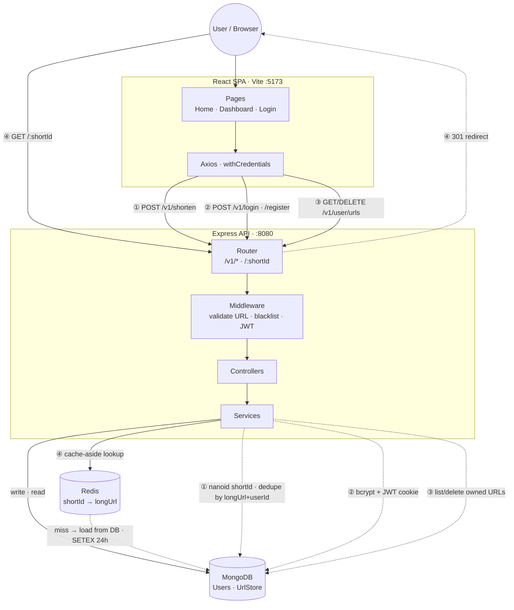

# URL Shortener

A full-stack URL shortener with optional user accounts. Guests can shorten links anonymously; registered users can manage their URLs from a dashboard. Redirects are accelerated with a Redis cache-aside layer.

## Tech Stack

| Layer | Technologies |
|-------|--------------|
| **Backend** | Node.js, Express 4 |
| **Database** | MongoDB (Mongoose) |
| **Cache** | Redis (ioredis) |
| **Auth** | JWT (HTTP-only cookies), bcrypt |
| **ID generation** | nanoid |
| **Config** | YAML (`config.yaml`) |
| **Frontend** | React 19, Vite, React Router, Tailwind CSS |
| **HTTP client** | Axios |

## Project Structure

```
url-shortener/
├── index.js                    # Entry point — creates Server, starts listening
├── config.yaml                 # Runtime config (ports, JWT, CORS, DB, blacklist)
├── src/
│   ├── app.js                  # Express Server class (middleware, DB, routes)
│   ├── config/                 # YAML config loader
│   ├── router/                 # Route definitions (v1 API + redirect)
│   ├── controllers/            # HTTP request/response handlers
│   ├── services/               # Business logic
│   ├── middlewares/            # Auth, URL validation, domain blacklist
│   ├── utils/                  # Validation helpers
│   └── database/
│       ├── mongodb/            # Connection + User / UrlStore models
│       └── redis/              # Singleton Redis client
└── client/url-shortener-ui/    # React SPA (pages, components, API client)
```

## Architecture

The backend follows a **layered architecture**:

```
Router → Middleware → Controller → Service → Model / Redis
```

| Layer | Responsibility |
|-------|----------------|
| **Router** | Maps HTTP paths to handlers |
| **Middleware** | Auth, validation, domain blacklist |
| **Controller** | Parses requests, sends HTTP responses |
| **Service** | Business logic (shorten, redirect, auth) |
| **Model / Redis** | Persistence and caching |

### Design Patterns

- **Singleton** — Redis client exports a single shared connection instance
- **Cache-aside** — Redirects check Redis first; on miss, load from MongoDB and cache for 24h
- **Middleware pipeline** — Express chains validation and auth before controllers
- **Optional auth** — URL shortening works for guests; logged-in users get URLs tied to their account

## High-Level Design

One diagram for the full system — components, layers, and the three main flows (shorten, redirect, auth):



| Flow | Path | What happens |
|------|------|--------------|
| **① Shorten** | `POST /v1/shorten` | Validate URL → optional JWT → generate or return existing short link |
| **② Auth** | `POST /v1/register`, `/login` | Register with bcrypt; login sets HTTP-only `authToken` cookie |
| **③ Dashboard** | `GET/DELETE /v1/user/urls` | JWT required → list or delete URLs owned by user |
| **④ Redirect** | `GET /:shortId` | Redis lookup → MongoDB on miss → 301 to original URL |

## API Routes

| Method | Path | Auth | Description |
|--------|------|------|-------------|
| `GET` | `/v1/health` | — | Health check |
| `POST` | `/v1/register` | — | Create account |
| `POST` | `/v1/login` | — | Login (sets `authToken` cookie) |
| `POST` | `/v1/shorten` | Optional | Create a short URL |
| `GET` | `/:id` | — | 301 redirect to original URL |
| `GET` | `/v1/user/urls` | Required | List user's shortened URLs |
| `DELETE` | `/v1/user/urls/:id` | Required | Delete a URL |
| `POST` | `/v1/user/logout` | — | Clear auth cookie |

## Data Model

**User** — `email` (unique), `password` (bcrypt hash), `createdAt`

**UrlStore** — `shortId` (unique), `longUrl`, `userId` (optional), `createdAt`

## Getting Started

### Prerequisites

- Node.js 18+
- MongoDB
- Redis

### Backend

```bash
npm install
npm run dev        # nodemon on port 8080
```

Config is loaded from `config.yaml` at the project root.

### Frontend

```bash
cd client/url-shortener-ui
npm install
npm run dev        # Vite dev server on port 5173
```

The UI talks to the API at `http://localhost:8080` with cookie-based auth (`withCredentials: true`).

### Docker (backend + MongoDB + Redis)

```bash
docker-compose up
```

This starts the Express app on `:8080`, Redis on `:6379`, and MongoDB on `:27018` (host port).

## Frontend Routes

| Route | Page | Description |
|-------|------|-------------|
| `/` | Home | Public shorten form |
| `/register` | Register | Account creation |
| `/login` | Login | Login → redirect to dashboard |
| `/dashboard` | Dashboard | Shorten URLs + manage your links |
