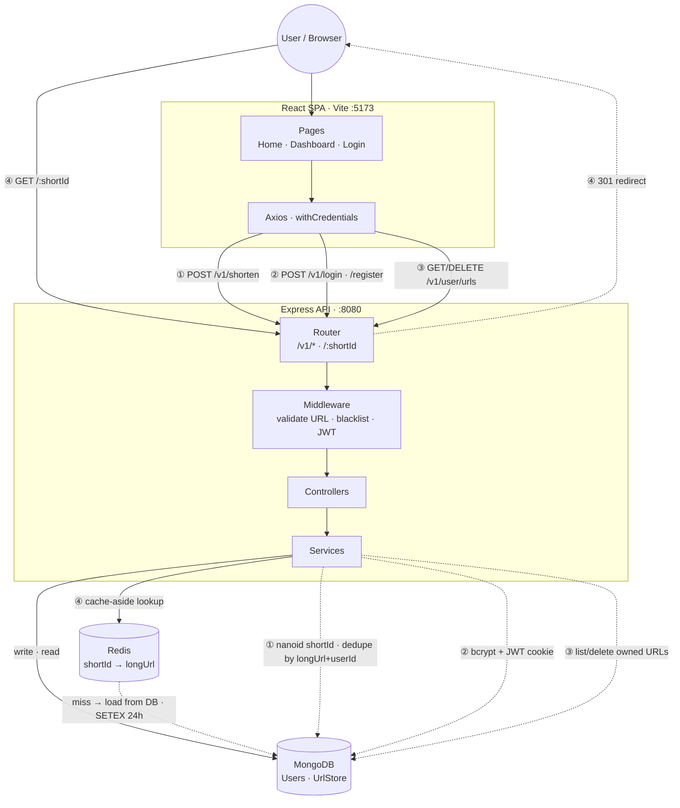

# URL Shortener

A full-stack URL shortener with optional user accounts and Redis-backed redirects.

## Tech Stack

| Layer | Technologies |
|-------|--------------|
| **Backend** | Node.js, Express 4 |
| **Database** | MongoDB (Mongoose) |
| **Cache** | Redis (ioredis) |
| **Auth** | JWT (HTTP-only cookies), bcrypt |
| **ID generation** | nanoid |
| **Config** | YAML (`config.yaml`) |
| **Frontend** | React 19, Vite, React Router, Tailwind CSS |
| **HTTP client** | Axios |

## High-Level Design

The React SPA talks to a layered Express API (`Router → Middleware → Controller → Service`). MongoDB is the source of truth; Redis caches redirect lookups for 24h (cache-aside). Guests can shorten URLs; logged-in users get a dashboard to manage their links.

| Flow | Path | What happens |
|------|------|--------------|
| **① Shorten** | `POST /v1/shorten` | Validate URL → optional JWT → generate or return existing short link |
| **② Auth** | `POST /v1/register`, `/login` | Register with bcrypt; login sets HTTP-only `authToken` cookie |
| **③ Dashboard** | `GET/DELETE /v1/user/urls` | JWT required → list or delete URLs owned by user |
| **④ Redirect** | `GET /:shortId` | Redis lookup → MongoDB on miss → 301 to original URL |
